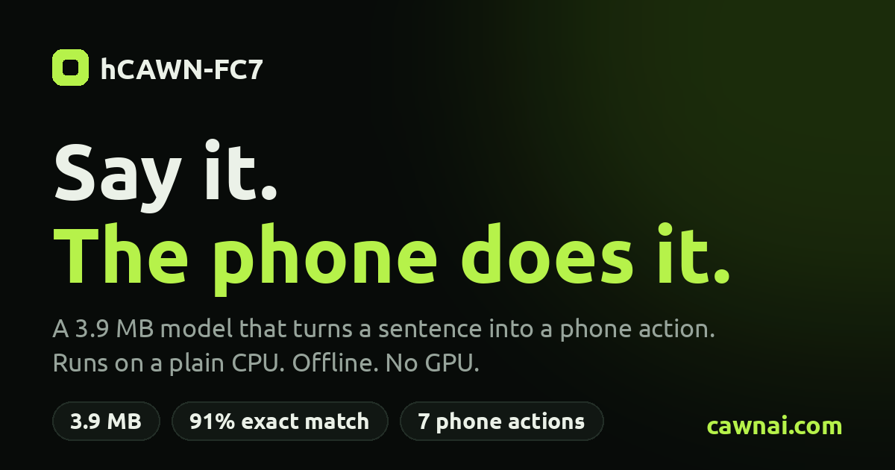

# hcawn-fc



A tiny function-calling model (5.7M parameters, byte-level, CPU only) for **7 phone actions**:
`send_email`, `create_calendar_event`, `create_contact`, `show_map`, `open_wifi_settings`, `turn_on_flashlight`, `turn_off_flashlight`.

It runs locally in well under a second, always returns valid JSON, and holds back calls it is not sure about.
Try it in the browser first: **https://cawnai.com**

> **Scope:** a narrow model for a known tool set, not a general function-calling model. It does not take arbitrary tool schemas.

## Install

```bash
pip install hcawn-fc
hcawn-fc doctor
hcawn-fc "Add a calendar event Team Sync tomorrow at 2pm"
```

Python 3.9+, any OS. Until you download the weights, `hcawn-fc` calls the hosted API (free demo). The local CPU engine ships for Linux x86-64, see "Run it locally".

## Run it locally

The local engine runs on your CPU with no network. The weights (6 MB int8, 3.9 MB int4, CC BY 4.0) are hosted on Hugging Face and downloaded once:

```bash
hcawn-fc download            # int8 (default); also: hcawn-fc download int4 | all
hcawn-fc doctor              # shows the engine, the weights and a self-test
```

They are saved to `~/.cache/hcawn_fc/` and checked against a SHA-256 sum. You can also pass your own file with `--model-path` / `Local(model_path=...)`.

## Use it from Python

```python
from hcawn_fc import Local

m = Local()                                   # needs the engine (Linux x86-64) and `hcawn-fc download`
r = m.call("Email dana@example.com subject Lunch body Are we still on for noon?")

r.status        # "ok" | "held" | "none"
r.calls         # [Call(name="send_email", arguments={...})]
r.confidence    # 0.0 - 1.0
r.latency_ms
```

Statuses:

| status | meaning |
|---|---|
| `ok` | the call is confident enough to act on (`r.calls`) |
| `held` | the model proposed a call but is not sure; ask the user first (`r.held_calls`) |
| `none` | none of the 7 actions fits the request |

Relative dates ("tomorrow", "next Monday") are computed from `now` (default: local time). Pass `m.call(q, now=datetime(...))` to override.
`Local(model="int4")` uses the smaller file; `Local(min_conf=0.95)` makes the gate stricter. One `Local` instance handles one request at a time (calls are serialized); use one instance per process for parallelism.

## Hosted API

```python
from hcawn_fc import Client
Client().call("Turn on the flashlight")        # https://cawnai.com, free demo, rate limited. Works on any OS.
```

or `hcawn-fc --api "Turn on the flashlight"`. Raises `RateLimited` / `ServerBusy` / `ApiError`.
Need higher limits or an SLA? Contact us (below).

## Command line

```
hcawn-fc "Show me Paris on the map"      one request
hcawn-fc chat                            interactive
hcawn-fc doctor                          what engine / weights / CPU variant is in use
  --api  --model int4  --json  --min-conf 0.95  --model-path file.bin
```

The engine ships in three builds (AVX2, SSE4.1, generic) and the fastest one your CPU supports is picked at start-up. Override with `HCAWN_FC_ISA=avx2|sse41|generic`.

## How good is it

Strict exact match (tool names and every argument value) on the Mobile Actions eval set, 961 rows, about ±2 points of noise. These numbers are for model **plus** the deterministic layers around it (grammar-constrained decoding, grounding of values in the query, date/time rules, keyword triggers, confidence gate):

| | Exact |
|---|---|
| int8 | 90.4% |
| int4 | 90.3% |
| int8 on rephrased queries (905 rows, paraphrased by a different LLM) | 82.8% |
| model + grammar only, no other layers (our own evaluator) | 86.5% |

The first three rows were measured with this package, and you can repeat them (see "Reproduce the numbers" below). Queries are limited to 300 characters; 46 of the 961 benchmark requests are longer, and on the 915 up to 300 characters int8 gets 90.3%.

Weaker on unusual phrasings ("tell him that ...", "... saying X"). The confidence gate is not a guarantee: it stops most, not all, wrong calls.

## Model details

| | |
|---|---|
| Parameters | 5,742,720 (5.74M) |
| Architecture | hCAWN hybrid: 6 layers (4 recurrent associative-memory layers and 2 local-attention layers), hidden size 128, 4 heads, local attention window of 4,096 bytes |
| Vocabulary | 258 symbols: 256 raw UTF-8 bytes plus start and end markers. No tokenizer |
| Files | int8 6.0 MB, int4 3.9 MB |
| Pretraining | next-byte prediction on English web text (FinePDFs-Edu, DCLM, FineWeb-Edu), no function-calling data. Best checkpoint at step 241,000 of 300,000 (about 15.8 billion bytes), validation loss 1.068 nats per byte on WikiText-103 |
| Fine-tuning | supervised, on Mobile Actions plus 16,000 LLM paraphrases of its requests. Examples of up to 2,048 bytes (tool definitions, date, request and answer) |
| Speed | median about 0.2 s (int8) and 0.3 s (int4) per request on one core of a desktop CPU with AVX2 |

**Why 300 characters?** It is a safety limit of the package and the demo, not a limit of the model. The tool definitions and the date take about 1.2 KB of the 2,048 bytes the model was fine-tuned on, so there are roughly 850 bytes left for the request and the answer. In the benchmark 4.8% of the requests are longer than 300 characters (up to 740), and the model gets 43 of those 46 right.

Full details: https://huggingface.co/datatab/hcawn-fc7

## Reproduce the numbers

The folder `eval_check/` has the evaluation requests and a short script that uses only this package and its own scorer (strict exact match):

```bash
pip install hcawn-fc
hcawn-fc download int8 && hcawn-fc download int4
cd eval_check
python3 verify_fc7.py data/fc_mobile_eval.jsonl --model int8 --procs 4 --allow-long
python3 verify_fc7.py data/fc_mobile_eval.jsonl --model int4 --procs 4 --allow-long
python3 verify_fc7.py data/fc_mobile_eval_para.jsonl --model int8 --procs 4 --allow-long --name rewritten
```

Expected: 90.4% (int8), 90.3% (int4) and 82.8% (rewritten requests), within about 2 points of noise. Every miss is written to `out/*_errors.jsonl`. The Linux x86-64 engine is needed.

## Data and licences

* Code: Apache-2.0. The native inference engine ships as a compiled binary inside the Linux x86-64 wheels; its source code is not published.
* Trained on the **Mobile Actions** dataset (Google, CC BY 4.0) plus query-form augmentation and 16,000 paraphrases of the training queries written by an LLM (Gemini 2.5 Flash Lite) and filtered automatically. Evaluation paraphrases were written by GPT-4o-mini and were never used for training.
* Model weights: CC BY 4.0 (Hugging Face: https://huggingface.co/datatab/hcawn-fc7). See `NOTICE`.
* Evaluation data in `eval_check/data/`: requests and expected calls derived from the Mobile Actions dataset (Google, CC BY 4.0), and 905 rewrites of them written by GPT-4o-mini.

## Custom models

We build small CPU-only models like this one for **your** tools and your phrasing, and run them on-device or on your own servers.
Contact: https://cawnai.com (contact form at the bottom).

## Serbian (Latin script)

A separate model understands Serbian requests (Latin script, with or without diacritics, typos included). It is not the English model: it was fine-tuned on Serbian only and is not meant for English.

```bash
hcawn-fc download sr-int8        # or sr-int4 (3.9 MB)
hcawn-fc --model sr-int8 "upali lampu"
hcawn-fc --model sr-int8 "zakazi sastanak sa Markom sutra u 15h"
```

```python
from hcawn_fc import Local

m = Local(model="sr-int8")
r = m.call("dodaj kontakt Marko Petrovic 064 123 4567")
print(r.status, r.calls)
```

On 450 requests rewritten as people type them (no diacritics, typos, lowercase), `sr-int8` gets 85.1% exact match and `sr-int4` 84.9%. At the default confidence gate (0.9) the model answers about 80% of requests and about 97% of those answers are exactly right. The weakest tool is `show_map`. The weights are in the Hugging Face repo [datatab/hcawn-fc7-sr](https://huggingface.co/datatab/hcawn-fc7-sr).
